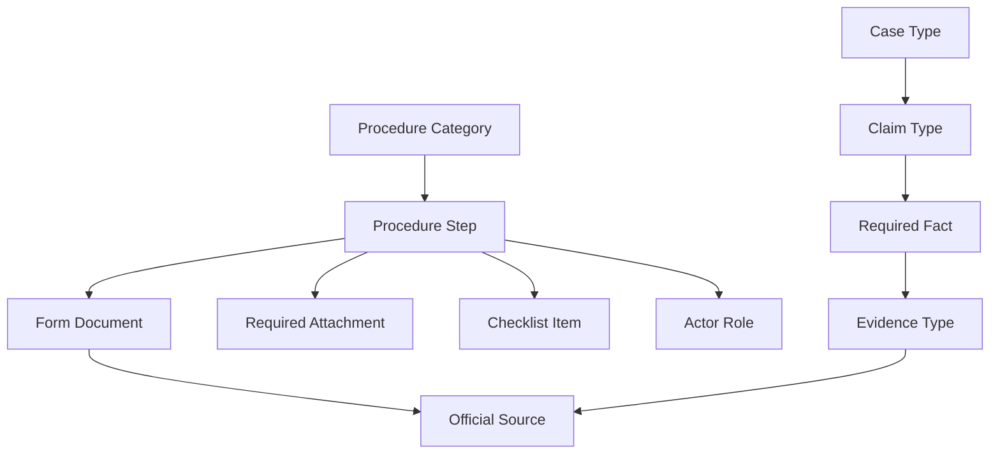
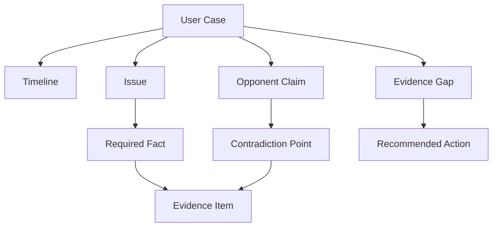

# Legal Procedure Knowledge Graph Draft

This document is a v0.1 draft for a legal procedure data-integration project.

The goal is to prepare for a DB / API / knowledge graph project based on official court procedure information.

This is not legal advice.
This is a procedure, checklist, form, and evidence-organization system design note for self-represented users.

```text
official court procedure
-> structured DB
-> API
-> knowledge graph
-> checklist navigator
-> future legal intake chatbot
```

---

## 1. Project Purpose

The project is designed for the course topic:

```text
Intelligent service data-integration project
-> public data / official procedure information
-> data structuring
-> DB / API / knowledge graph output
```

The practical product direction is:

```text
Legal Procedure & Evidence Checklist Navigator
```

Korean direction:

```text
나홀로소송 절차·증거 체크리스트 내비게이터
```

The system should help users understand:

```text
What type of case is this?
Which procedure stage am I in?
Which documents or forms are needed?
Which evidence should I prepare?
What is the next expected step?
Which official source should I check?
```

The first version should focus on structure, not legal judgment.

```text
Do:
-> procedure navigation
-> checklist generation
-> official form linking
-> evidence preparation guide
-> stage tracking

Do not:
-> guarantee legal outcome
-> decide winning probability
-> replace lawyer judgment
-> provide final legal advice
```

---

## 2. Scope For v0.1

The v0.1 scope is intentionally limited.

```text
Civil
-> electronic litigation
-> civil lawsuit procedure
-> complaint filing
-> representative civil claim types
-> litigation aid
-> evidence checklist

Family
-> family non-contentious procedure
-> family procedure aid
-> guardianship / child support / visitation / parental authority / adoption
-> required documents and checklist

Criminal
-> complainant-centered procedure
-> police investigation
-> transfer to prosecution
-> supplementary investigation
-> indictment / non-indictment stage
-> evidence-first checklist
```

Out of scope for v0.1:

```text
patent litigation
bankruptcy / rehabilitation
complex enforcement
deep case-law analysis
RAG answer generation
NVIDIA NeMo Guardrails implementation
full legal chatbot
```

---

## 3. Product Layers

The project can be split into four layers.

```text
1. Official Procedure Layer
2. Form / Document Layer
3. Evidence Checklist Layer
4. User Case Navigation Layer
```

### 3.1 Official Procedure Layer

This layer stores official court procedure concepts.

Examples:

```text
electronic litigation
civil complaint filing
answer submission
service of documents
case record viewing
litigation aid
family procedure aid
criminal complaint
supplementary investigation
```

### 3.2 Form / Document Layer

This layer links official forms to procedure steps.

Examples:

```text
complaint form
answer form
preparatory brief
litigation aid application
family procedure aid application
property statement
payment order application
small claim form
```

The key idea:

```text
procedure step
-> requires form
-> requires attachment
-> has official source
```

### 3.3 Evidence Checklist Layer

This layer maps case type or stage to evidence preparation.

Examples:

```text
loan claim
-> loan agreement
-> transfer record
-> repayment demand notice
-> chat messages

lease deposit claim
-> lease contract
-> deposit transfer record
-> termination notice
-> registration certificate

criminal supplementary investigation
-> timeline
-> public official documents
-> opponent claim contradiction
-> issue-to-evidence table
```

### 3.4 User Case Navigation Layer

This layer translates user status into next-step guidance.

Example:

```text
User:
"I filed a criminal complaint. It was transferred to prosecution,
but supplementary investigation came back."

System:
-> role = COMPLAINANT
-> stage = SUPPLEMENTARY_INVESTIGATION_AFTER_TRANSFER
-> checklist = supplementary investigation checklist
-> next steps = police supplementary investigation / prosecutor review / indictment or non-indictment
```

---

## 4. Core Entities

Draft DB entities:

```text
ProcedureCategory
ProcedureStep
ActorRole
FormDocument
RequiredAttachment
EvidenceType
EvidenceChecklist
ChecklistItem
CaseType
ClaimType
RequiredFact
ProcedureRule
SourceReference
```

Legal intake extension entities:

```text
UserCase
CaseStage
CaseTimeline
Issue
EvidenceItem
EvidenceGap
OpponentClaim
ContradictionPoint
ReadinessScore
RecommendedAction
```

---

## 5. Knowledge Graph Model

The graph should show how legal procedure information connects.

```text
ProcedureCategory hasStep ProcedureStep
ProcedureStep requiresForm FormDocument
ProcedureStep requiresAttachment RequiredAttachment
ProcedureStep hasActorRole ActorRole
ProcedureStep hasChecklist ChecklistItem
CaseType hasClaimType ClaimType
ClaimType requiresFact RequiredFact
RequiredFact supportedBy EvidenceType
EvidenceChecklist belongsTo ProcedureStep
FormDocument hasSource SourceReference
```

Extended evidence-first graph:

```text
UserCase hasTimeline CaseTimeline
UserCase hasIssue Issue
Issue requiresFact RequiredFact
RequiredFact supportedBy EvidenceItem
EvidenceItem hasSource SourceReference
OpponentClaim contradicts EvidenceItem
UserCase hasEvidenceGap EvidenceGap
EvidenceGap recommends RecommendedAction
```

Mermaid draft:



Evidence-first case graph:



---

## 6. Civil Module

Civil module position:

```text
self-represented civil procedure navigator
```

Main nodes:

```text
ELECTRONIC_LITIGATION
CIVIL_LITIGATION
CIVIL_COMPLAINT
ANSWER_SUBMISSION
SERVICE_OF_DOCUMENTS
CASE_RECORD_VIEW
LITIGATION_AID
```

Representative civil claim types:

```text
LOAN_CLAIM
LEASE_DEPOSIT_CLAIM
WAGE_CLAIM
SALES_PAYMENT_CLAIM
GOODS_PAYMENT_CLAIM
CONSTRUCTION_PAYMENT_CLAIM
CAR_DAMAGE_CLAIM
BUILDING_DELIVERY_CLAIM
PAYMENT_ORDER
SMALL_CLAIM
```

Civil checklist:

```text
1. Identify claim type
2. Identify plaintiff and defendant
3. Confirm jurisdiction
4. Define claim purpose
5. Define claim reason
6. Prepare evidence
7. Prepare complaint
8. Check court fee and service fee
9. Submit through electronic litigation if available
10. Track answer submission and hearing schedule
```

Example civil evidence mapping:

```text
LEASE_DEPOSIT_CLAIM
-> lease contract
-> deposit transfer record
-> termination notice
-> registration certificate
-> message or notice requesting return
```

---

## 7. Litigation Aid Module

Litigation aid is a cost-support procedure.

Main purpose:

```text
Help users identify whether they may request payment deferment or exemption
for certain litigation costs.
```

Main nodes:

```text
LITIGATION_AID
ELIGIBLE_CASE
APPLICANT_TYPE
FINANCIAL_REQUIREMENT
NOT_CLEARLY_LOSING_REQUIREMENT
PROPERTY_STATEMENT
FINANCIAL_PROOF_DOCUMENT
```

Eligible case examples:

```text
civil lawsuit
administrative lawsuit
family lawsuit
payment order
civil execution
provisional attachment
provisional disposition
```

Criminal case:

```text
not eligible under this litigation-aid category
```

Checklist:

```text
1. Is the case eligible?
2. Is the applicant before filing or already in litigation?
3. Which court should receive the application?
4. Is there a simplified financial proof document?
5. Is a property statement required?
6. Are required receipts attached?
7. Is the claim clearly abusive or legally impossible?
```

---

## 8. Family Module

Family module position:

```text
family non-contentious procedure and procedure-aid navigator
```

Main nodes:

```text
FAMILY_NON_CONTENTIOUS_CASE
FAMILY_PROCEDURE_AID
GUARDIANSHIP
PROPERTY_DIVISION
CHILD_SUPPORT
VISITATION
PARENTAL_AUTHORITY
ADOPTION
NAME_OR_ORIGIN_CHANGE
PROPERTY_MANAGER_APPOINTMENT
MISSING_PERSON_DECLARATION
```

Family procedure aid requirements:

```text
LACK_OF_FINANCIAL_ABILITY
NO_CLEAR_IMPROPER_PURPOSE
```

Family checklist:

```text
1. Identify family case type
2. Confirm whether it is a family non-contentious case
3. Confirm applicant role
4. Confirm current stage
5. Check procedure-aid eligibility
6. Prepare property statement if needed
7. Prepare family relation documents
8. Prepare related evidence or application documents
```

---

## 9. Criminal Module

Criminal module position:

```text
complainant-side criminal procedure and evidence checklist navigator
```

This module should not be designed as a criminal legal-advice engine.

It should help complainants and victims understand:

```text
current stage
actor roles
what to prepare
what evidence is missing
what next step may happen
```

Formal procedure stages:

```text
COMPLAINT_FILED
POLICE_INVESTIGATION
COMPLAINANT_STATEMENT
SUSPECT_INVESTIGATION
EVIDENCE_SUBMISSION
TRANSFER_TO_PROSECUTION
PROSECUTOR_REVIEW
SUPPLEMENTARY_INVESTIGATION_REQUEST
POLICE_SUPPLEMENTARY_INVESTIGATION
SUPPLEMENTARY_RESULT_TRANSFER
PROSECUTOR_FINAL_DECISION
INDICTMENT
NON_INDICTMENT
CRIMINAL_TRIAL
JUDGMENT
APPEAL
```

Important role distinction:

```text
civil:
plaintiff / defendant

criminal investigation:
complainant / victim / accused person / suspect

criminal trial:
prosecutor / defendant
```

The complainant is not the plaintiff in the criminal trial.

---

## 10. Criminal Complainant Work Layer

In practice, complainants often need to organize facts and evidence actively.

This project should model that workload separately.

```text
ComplainantWorkLayer
-> evidence collection
-> official document tracking
-> timeline construction
-> issue mapping
-> issue-to-evidence mapping
-> supplementary submission
-> counter-statement preparation
-> investigation status tracking
```

Core checklist:

```text
1. Confirm case number
2. Confirm current agency
3. Confirm current investigator or contact point
4. Confirm current stage
5. Prepare timeline
6. Prepare evidence list
7. Map evidence to issue
8. Identify missing evidence
9. Identify official documents to request
10. Identify opponent claim contradictions
11. Prepare supplementary submission if needed
```

Supplementary investigation checklist:

```text
1. Confirm why supplementary investigation was requested
2. Identify what issue was considered insufficient
3. Review whether evidence was already submitted
4. Add missing official documents if possible
5. Strengthen timeline
6. Prepare issue-to-evidence table
7. Prepare response to suspect's expected claim
8. Track re-transfer or follow-up decision
```

---

## 11. Evidence-First Intake Model

The system should be evidence-first.

Problem:

```text
Users often explain unfairness emotionally.
Institutions need structured facts and evidence.
```

System direction:

```text
user story
-> timeline
-> issues
-> required facts
-> evidence
-> missing evidence
-> next action
```

Evidence entity draft:

```text
EvidenceItem
-> evidenceId
-> evidenceType
-> title
-> source
-> date
-> holder
-> relatedFact
-> relatedIssue
-> submitted
-> submissionDate
-> reliabilityLevel
```

Evidence types:

```text
DOCUMENT_EVIDENCE
PUBLIC_OFFICIAL_DOCUMENT
MESSAGE_RECORD
CALL_RECORD
TRANSACTION_RECORD
PHOTO_VIDEO
WITNESS_STATEMENT
MEDICAL_RECORD
CONTRACT
COURT_DOCUMENT
ADMINISTRATIVE_DOCUMENT
```

---

## 12. API Draft

Procedure APIs:

```http
GET /api/legal/procedures
GET /api/legal/procedures/{category}
GET /api/legal/procedures/{category}/steps
GET /api/legal/procedures/{category}/steps/{stepCode}
```

Civil APIs:

```http
GET /api/legal/civil/claim-types
GET /api/legal/civil/claim-types/{claimType}
GET /api/legal/civil/claim-types/{claimType}/evidence
GET /api/legal/civil/litigation-aid/checklist
```

Family APIs:

```http
GET /api/legal/family/case-types
GET /api/legal/family/procedure-aid/checklist
GET /api/legal/family/procedure-aid/documents
```

Criminal APIs:

```http
GET /api/legal/criminal/stages
GET /api/legal/criminal/stages/{stageCode}
GET /api/legal/criminal/checklist/complainant
GET /api/legal/criminal/checklist/supplementary-investigation
```

Form APIs:

```http
GET /api/legal/forms
GET /api/legal/forms/{formCode}
GET /api/legal/forms?procedure={procedureCode}
GET /api/legal/forms?caseType={caseType}
```

Navigation API:

```http
POST /api/legal/navigator/analyze
```

Example request:

```json
{
  "domain": "criminal",
  "role": "complainant",
  "currentStage": "supplementary_investigation_after_transfer",
  "summary": "The case was transferred to prosecution, but supplementary investigation came back.",
  "hasTimeline": true,
  "hasEvidenceList": true,
  "hasOfficialDocuments": true,
  "needsChecklist": true
}
```

Example response:

```json
{
  "domain": "criminal",
  "role": "COMPLAINANT",
  "stageCode": "SUPPLEMENTARY_INVESTIGATION_AFTER_TRANSFER",
  "stageLabel": "검찰 송치 후 보완수사 단계",
  "checklist": [
    "보완수사 요구 취지 확인",
    "추가 증거 정리",
    "시간순 사건표 보강",
    "쟁점별 증거표 작성",
    "상대방 주장 반박자료 준비"
  ],
  "nextExpectedSteps": [
    "경찰 보완수사",
    "검찰 재검토",
    "기소 또는 불기소 판단"
  ],
  "boundary": "This system provides procedure and checklist guidance, not legal advice."
}
```

---

## 13. DB Table Draft

Simple relational DB draft:

```text
procedure_category
procedure_step
actor_role
form_document
required_attachment
case_type
claim_type
required_fact
evidence_type
checklist
checklist_item
source_reference
```

Relationship tables:

```text
procedure_step_form
procedure_step_attachment
procedure_step_checklist
claim_type_required_fact
required_fact_evidence_type
case_type_procedure_category
```

Future user data tables:

```text
user_case
case_timeline_event
case_issue
case_evidence_item
case_evidence_gap
case_navigation_history
```

---

## 14. Study Notes For Implementation

The DB project can be implemented in a familiar Spring structure.

```text
DTO
-> Controller
-> Service
-> Repository
-> Entity
-> DB
```

Example flow:

```text
React or Postman request
-> Spring Controller
-> DTO
-> Service searches procedure data
-> Repository reads DB
-> Service builds checklist response
-> JSON response
```

For the course project, the most important learning goal is:

```text
official legal procedure text
-> structured data model
-> DB tables
-> API response
-> graph relationship explanation
```

---

## 15. Future Chatbot Direction

This draft can later become the knowledge base for a legal intake chatbot.

Future chatbot:

```text
user narrative
-> classify domain
-> identify procedure stage
-> ask missing questions
-> recommend checklist
-> recommend official forms
-> build evidence map
-> create consultation packet
```

Future integrations:

```text
React UI
SSE streaming
JWT login
chat history
intake history
RAG
NVIDIA NeMo Guardrails
LangChain / LangGraph
Prometheus observability
```

---

## 16. One-Line Portfolio Thesis

```text
This project converts official court procedure information into a structured DB, API, and knowledge graph for self-represented users, focusing on procedure navigation, official forms, evidence checklists, and next-step guidance.
```

Korean version:

```text
이 프로젝트는 공식 법원 절차 정보를 DB, API, 지식 그래프로 구조화하여
나홀로소송 이용자에게 절차 단계, 공식 양식, 증거 체크리스트,
다음 행동을 안내하는 시스템이다.
```
